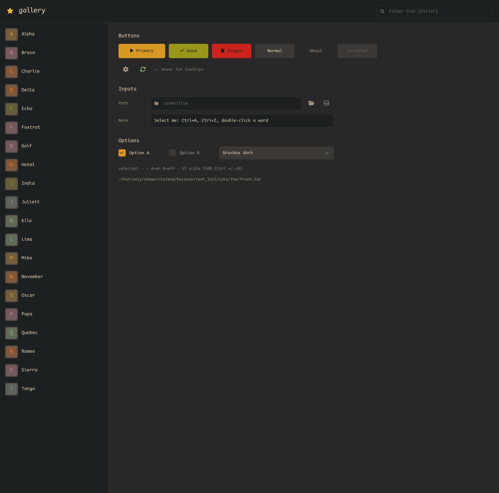

# bmu — build my ui

A small immediate-mode desktop UI kit for [C3](https://c3-lang.org) + raylib 6, with a Gruvbox dark look and an
embedded Nerd Font.



- Widgets: buttons (5 styles), icon buttons with tooltips, checkboxes, dropdowns, single-line text inputs with
  real editing (selection, word jumps, clipboard, undo/redo, keyboard-layout-aware shortcuts), scroll areas,
  image/letter tiles, toasts, modal dialogs.
- A built-in file/folder picker (no GTK, no portals, no zenity).
- HiDPI: everything is laid out in logical pixels; Ctrl +/−/0 zooms the whole UI.
- `txt` (fixed char buffers, case-insensitive and natural compare, path helpers) and `sys` (POSIX files, dirs,
  processes) work without a window too.
- `--shot out.png` on any app saves a screenshot and exits (for checks and docs).
- Static raylib in `lib/raylib6.c3l`; no other dependencies. Linux x86_64.

```c3
// sketch
ui::open("Hello", 640, 360);
while (ui::running())
{
	ui::frame_begin();
	if (ui::button({ 20, 20, 140, 40 }, "Click me", PRIMARY, ui::I_STAR)) ui::toast("Hi!");
	ui::frame_end();
}
```

## Build and run

```sh
c3c build example-gallery && ./build/example-gallery
c3c build bmu-check && ./build/bmu-check      # headless tests
dev/tools/check-docs.sh                               # every code block in docs/ compiles
tools/new-app.sh ../my-app "My App"     # new app with bmu as a submodule
```

Documentation: [docs/README.md](docs/README.md). Start with [GETTING_STARTED](docs/GETTING_STARTED.md), keep
[QUICK_REFERENCE](docs/QUICK_REFERENCE.md) open.

## License

Code: MIT (`LICENSE`). Font: CodeNewRoman Nerd Font Propo, SIL Open Font License 1.1 (`lib/bmu.c3l/assets/OFL.txt`).
raylib: zlib license (`lib/raylib6.c3l/LICENSE`).
